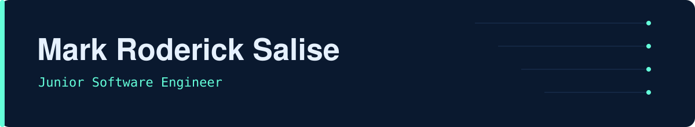
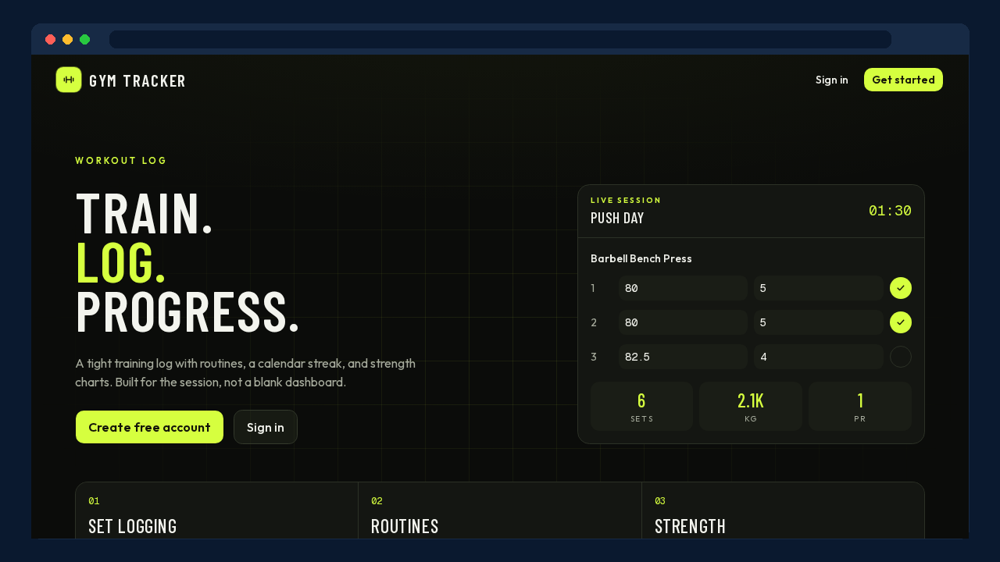
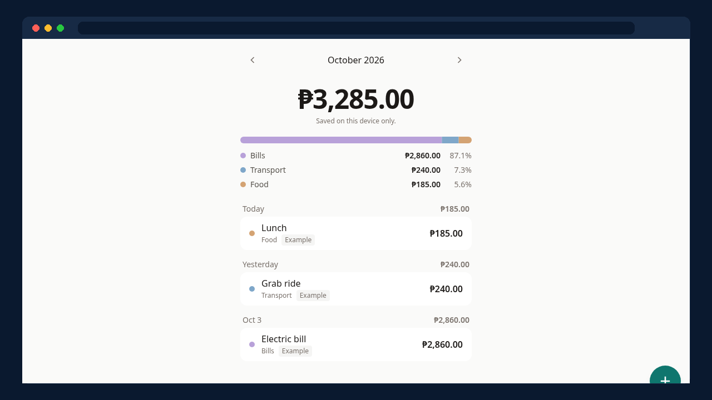
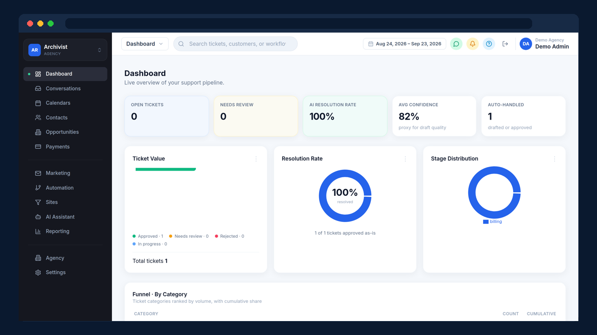
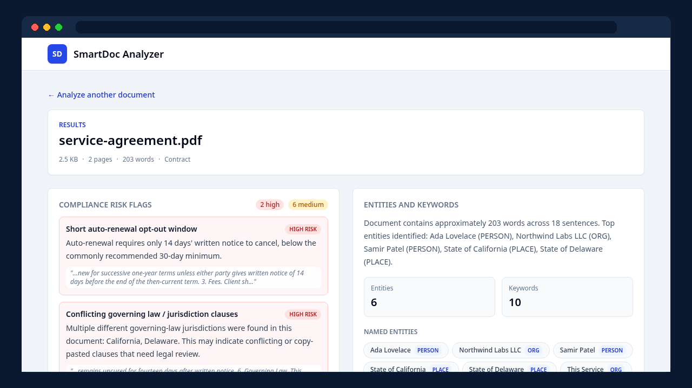

<a href="https://markroderick.vercel.app">
  <picture>
    <source media="(prefers-color-scheme: dark)" srcset="assets/banner-dark.svg">
    <source media="(prefers-color-scheme: light)" srcset="assets/banner-light.svg">
    
  </picture>
</a>

Junior Software Engineer from San Pedro, Laguna. I build full-stack apps with TypeScript and Python, plus some blockchain work with Hyperledger. Open to junior software engineer roles.

  

### Featured work

<table>
  <tr>
    <td width="50%" valign="top">
      
      
<b>Gym App Tracker</b> Log sets, time rest, and track workouts. Full-stack TypeScript.

      
<a href="https://gym-app-tracker-gamma.vercel.app">Live</a> · <a href="https://github.com/Tofuwuuu/Gym-App-Tracker">Code</a>

    </td>
    <td width="50%" valign="top">
      
      
<b>Expense Tracker</b> Track spending by day, month, and category. Saves in your browser.

      
<a href="https://expense-tracker-brown-zeta-75.vercel.app">Live</a>

    </td>
  </tr>
  <tr>
    <td width="50%" valign="top">
      
      
<b>AI Ops Assistant</b> An AI helper for ops and incident work.

      
<a href="https://ai-ops-assistant-wheat.vercel.app">Live</a> · <a href="https://github.com/Tofuwuuu/AI-Ops-Assistant">Code</a>

    </td>
    <td width="50%" valign="top">
      
      
<b>SmartDoc Analyzer</b> Upload a document and AI extracts, summarizes, and structures its content.

      
<a href="https://smartdoc-analyzer.vercel.app">Live</a> · <a href="https://github.com/Tofuwuuu/SmartDoc-Analyzer">Code</a>

    </td>
  </tr>
</table>

### More projects

<table>
  <tr>
    <td colspan="2" width="33%" valign="top">
      <b><a href="https://github.com/Tofuwuuu/Collaborative-Real-Time-Document-Editor">Collaborative Doc Editor</a></b> 
      
      
Edit documents together in real time.

      
<a href="https://collaborative-real-time-document-ed.vercel.app">Live</a> (first load takes about 30 seconds) · <a href="https://github.com/Tofuwuuu/Collaborative-Real-Time-Document-Editor">Code</a>

    </td>
    <td colspan="2" width="33%" valign="top">
      <b><a href="https://github.com/Tofuwuuu/Hyperledger-Document-Verification-">Hyperledger Document Verification</a></b> 
      
      
Verify documents on a permissioned blockchain.

      
<a href="https://hyperledger-document-verification.vercel.app">Demo (screens only)</a> · <a href="https://github.com/Tofuwuuu/Hyperledger-Document-Verification-">Code</a>

    </td>
    <td colspan="2" width="33%" valign="top">
      <b><a href="https://github.com/Tofuwuuu/Folder-Storage">Folder Storage</a></b> 
       
      
Keeps file records in a folder tree on Hyperledger Fabric, and lets you grant or revoke each organization's read access.

      
<a href="https://github.com/Tofuwuuu/Folder-Storage">Code</a>

    </td>
  </tr>
  <tr>
    <td colspan="3" width="50%" valign="top">
      <b><a href="https://github.com/Tofuwuuu/API-Rate-Limiting-Gateway-System">API Rate Limiting Gateway</a></b> 
      
      
Rate-limits each API key with a sliding window and returns a 429 when a client goes over.

      
<a href="https://github.com/Tofuwuuu/API-Rate-Limiting-Gateway-System">Code</a>

    </td>
    <td colspan="3" width="50%" valign="top">
      <b><a href="https://github.com/Tofuwuuu/Distributed-Job-Queue">Distributed Job Queue</a></b> 
      
      
Runs background jobs by priority, retries failures up to three times, then moves them to a dead letter queue.

      
<a href="https://github.com/Tofuwuuu/Distributed-Job-Queue">Code</a>

    </td>
  </tr>
</table>

### Contact

  &nbsp;
  &nbsp;
  

<picture>
  <source media="(prefers-color-scheme: dark)" srcset="assets/footer-dark.svg">
  <source media="(prefers-color-scheme: light)" srcset="assets/footer-light.svg">
  
</picture>
